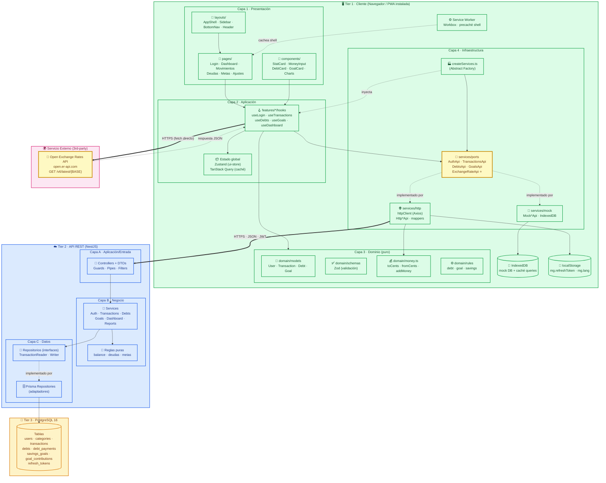

# Entrega — Aplicación basada en componentes distribuidos

**Curso:** Tecnologías de Construcción de Software  
**Tema:** Aplicación basada en componentes distribuidos  
**Alumno:** Nicolle Lozano Vega  
**Proyecto:** Gestor Económico Personal

---

## 1. Descripción de la solución

El **Gestor Económico Personal** es una aplicación **distribuida** organizada en **tres tiers físicos** y **múltiples capas lógicas**, comunicadas por red. Además, el frontend **consume un servicio externo de terceros** (API pública de tipos de cambio) para convertir importes entre las monedas soportadas.

### 1.1 Componentes distribuidos del sistema

| Tier | Componente | Tecnología | Rol |
|------|------------|------------|-----|
| 1 | **Cliente PWA** | React 18 + Vite + Tailwind | Interfaz de usuario, lógica de dominio, caché offline |
| 2 | **API REST** | NestJS 10 + Prisma | Reglas de negocio, autenticación JWT, orquestación |
| 3 | **Base de datos** | PostgreSQL 16 | Persistencia de usuarios, movimientos, deudas, metas |
| 4 | **Servicio externo** | `open.er-api.com` | Tipos de cambio entre monedas (consumido **desde el frontend**) |

La distribución se logra mediante **HTTPS + JSON + JWT** entre el cliente y la
API, y **HTTPS + JSON** entre el cliente y el servicio externo.

### 1.2 Naturaleza distribuida

- **Cliente ↔ API:** comunicación por red (REST). El cliente no conoce la BD.
- **API ↔ BD:** comunicación por red (TCP, driver `pg` vía Prisma).
- **Cliente ↔ Servicio externo:** comunicación por red directa (sin pasar por
  la API), demostrando que el frontend es un **cliente distribuido activo**.
- **Service Worker:** componente autónomo que precachea el shell y permite
  lectura offline.

---

## 2. Diagrama de componentes



### 2.1 Explicación del diagrama

| Elemento | Tipo | Descripción |
|----------|------|-------------|
| **Tier 1 · Cliente** | Componente distribuido | PWA que corre en el navegador del usuario. Contiene 4 capas lógicas internas. |
| **Tier 2 · API REST** | Componente distribuido | Servidor NestJS con 3 capas lógicas. Expone `/api/v1`. |
| **Tier 3 · PostgreSQL** | Componente distribuido | Base de datos relacional en contenedor Docker. |
| **Servicio Externo** | Componente de terceros | API pública de tipos de cambio. **Consumido directamente desde el frontend.** |
| **Service Worker** | Componente auxiliar | Corre en un hilo separado del navegador. Precachea el shell y sirve offline. |
| **IndexedDB** | Almacén local | Persiste el mock y la caché de TanStack Query. |
| **localStorage** | Almacén local | Guarda `refreshToken` y preferencia de idioma. |

### 2.2 Flujos de comunicación

1. **UI → Hooks → Services → API (HTTPS/JWT):** flujo típico de cualquier
   operación CRUD (crear movimiento, listar deudas, etc.).
2. **UI → Hooks → Servicio Externo (HTTPS directo):** el frontend consulta
   los tipos de cambio **sin pasar por la API**. Esto demuestra que el
   cliente es un componente distribuido activo, no solo un consumidor pasivo.
3. **API → Repositorios → PostgreSQL:** la API persiste y consulta la BD.
4. **Service Worker ↔ Caché:** intercepta peticiones y sirve el shell desde
   precaché; las llamadas a `/api/**` van siempre a red (`NetworkOnly`).

---

## 3. Consumo del servicio externo desde el frontend

### 3.1 Servicio elegido

**API:** [Open Exchange Rates API](https://www.exchangerate-api.com/docs/free)  
**Endpoint:** `GET https://open.er-api.com/v6/latest/{BASE}`  
**Autenticación:** ninguna (API pública, sin key)  
**CORS:** habilitado (permite llamadas desde el navegador)  
**Formato:** JSON  
**Límite:** 1 petición por día por base (suficiente para el caso de uso)

### 3.2 Caso de uso

En **Ajustes → Preferencias → Moneda**, cuando el usuario cambia su moneda
base (por ejemplo de `PEN` a `USD`), el sistema muestra una **vista previa
de conversión** de sus importes principales (saldo actual, gastos del mes,
total ahorrado). Esa conversión se hace con el tipo de cambio **en vivo**
obtenido del servicio externo.

### 3.3 Arquitectura de la integración

Respetando la arquitectura de puertos y adaptadores del proyecto:

```
features/settings/useExchangeRates.ts   ← hook (aplicación)
           ↓
services/ports/ExchangeRateApi.ts       ← puerto (interfaz)
           ↓
services/external/HttpExchangeRateApi.ts ← adaptador (HTTP directo)
           ↓
https://open.er-api.com/v6/latest/{BASE} ← servicio externo
```

> **Nota:** este adaptador vive en `services/external/` (nueva carpeta) y
> **no** usa el `httpClient` con JWT, porque el servicio externo no requiere
> autenticación. Usa `fetch` nativo o una instancia Axios sin interceptores.

### 3.4 Código

**Puerto — `services/ports/ExchangeRateApi.ts`:**

```ts
export interface ExchangeRates {
  base: string;
  rates: Record<string, number>;
  fetchedAt: string; // ISO 8601
}

export interface ExchangeRateApi {
  /** Obtiene los tipos de cambio con base en `base` (ej. "PEN"). */
  getRates(base: string): Promise<ExchangeRates>;
}
```

**Adaptador — `services/external/HttpExchangeRateApi.ts`:**

```ts
import type { ExchangeRateApi, ExchangeRates } from '../ports/ExchangeRateApi';
import { ApiError } from '../http/ApiError';

const BASE_URL = 'https://open.er-api.com/v6/latest';

export class HttpExchangeRateApi implements ExchangeRateApi {
  async getRates(base: string): Promise<ExchangeRates> {
    try {
      const res = await fetch(`${BASE_URL}/${base}`);
      if (!res.ok) {
        throw new ApiError({
          status: res.status,
          code: 'UNKNOWN',
          message: 'No se pudo obtener el tipo de cambio.',
          retryable: res.status >= 500,
        });
      }
      const data = await res.json();
      return {
        base: data.base_code,
        rates: data.rates,
        fetchedAt: new Date(data.time_last_update_unix * 1000).toISOString(),
      };
    } catch (e) {
      if (e instanceof ApiError) throw e;
      throw new ApiError({
        status: 0,
        code: 'NETWORK_ERROR',
        message: 'Sin conexión con el servicio de tipos de cambio.',
        retryable: true,
      });
    }
  }
}
```

**Hook — `features/settings/useExchangeRates.ts`:**

```ts
import { useQuery } from '@tanstack/react-query';
import { useServices } from '@/app/providers/ServicesProvider';
import { queryKeys } from '@/features/queryKeys';

export function useExchangeRates(base: string) {
  const { exchangeRates } = useServices();
  return useQuery({
    queryKey: queryKeys.exchangeRates(base),
    queryFn: () => exchangeRates.getRates(base),
    staleTime: 1000 * 60 * 60 * 12, // 12 h: la API actualiza 1× día
    retry: 1,
  });
}
```

**Uso en UI — `components/settings/CurrencyPreview.tsx`:**

```tsx
export function CurrencyPreview({ amount, from, to }: Props) {
  const { data, isLoading, error } = useExchangeRates(from);

  if (isLoading) return <LoadingSkeleton lines={1} />;
  if (error)     return <ErrorState error={error} onRetry={() => {}} />;
  if (!data)     return null;

  const rate = data.rates[to];
  const converted = fromCents(Math.round(toCents(amount) * rate));

  return (
    <p className="text-sm text-muted-foreground">
      {formatMoney(amount, from)} ≈ <strong>{formatMoney(converted, to)}</strong>
      <span className="ml-2 text-xs">
        (1 {from} = {rate.toFixed(4)} {to} · {formatRelative(data.fetchedAt)})
      </span>
    </p>
  );
}
```

**Registro en la factory — `services/createServices.ts`:**

```ts
export function createServices(): Services {
  return {
    auth:         env.dataSource === 'http' ? new HttpAuthApi(httpClient) : new MockAuthApi(),
    // … resto de servicios …
    exchangeRates: new HttpExchangeRateApi(), // siempre real, no hay mock
  };
}
```

### 3.5 Manejo de errores y resiliencia

| Caso | Comportamiento |
|------|----------------|
| Sin conexión | `ApiError NETWORK_ERROR` → toast ámbar "Sin conexión. No se pudo actualizar el tipo de cambio." |
| API caída (5xx) | `retryable: true` → TanStack Query reintenta 1 vez; luego `ErrorState` con botón "Reintentar". |
| Moneda no soportada | El dropdown solo ofrece las 8 del PRD; si la API no devuelve alguna, se oculta. |
| Caché | `staleTime` de 12 h → no se consulta más de 2 veces al día. |

### 3.6 Por qué se consume desde el frontend (y no desde el backend)

- **Requisito de la tarea:** demostrar que el frontend es un cliente
  distribuido capaz de consumir servicios externos por sí mismo.
- **KISS/YAGNI:** evitar añadir un endpoint proxy al backend para algo que
  es puramente informativo.
- **CORS:** la API elegida permite llamadas desde el navegador, no requiere
  ocultar credenciales (no hay API key).
- **Aislamiento:** si en el futuro se necesita cachear en el backend, basta
  con crear `HttpExchangeRateApi` en el backend y cambiar el puerto del
  frontend para que apunte a la API propia; el resto del código no cambia.


---

## 5. Conclusiones

- La aplicación es **distribuida en 3 tiers** (cliente, API, BD) más un
  **servicio externo** de terceros.
- El **frontend es un componente distribuido activo**: no solo consume su
  propia API, también consume un servicio externo por HTTPS directo.
- La arquitectura de **puertos y adaptadores** permitió integrar el servicio
  externo **sin romper** las reglas de dependencia: el hook solo conoce la
  interfaz `ExchangeRateApi`, y el adaptador concreto vive en
  `services/external/`.
- El servicio elegido es **gratuito, sin API key y con CORS habilitado**,
  lo que lo hace ideal para una PWA.
- El sistema maneja **errores de red y de servidor** de forma explícita con
  `ApiError` + `retry` + `ErrorState`.

---

## 6. Referencias

- Open Exchange Rates API: <https://www.exchangerate-api.com/docs/free>
- Documentación de Mermaid: <https://mermaid.js.org/>
- Especificación del proyecto: `SPEC.md` (§1.1 — arquitectura N-Capas;
  §1.4 — reglas de dependencia; §5.2 — puertos y adaptadores).
- Decisión registrada en `docs/DECISIONS.md`: _"Se añade el puerto
  `ExchangeRateApi` consumido directamente desde el frontend como
  requerimiento de la tarea de componentes distribuidos."_
