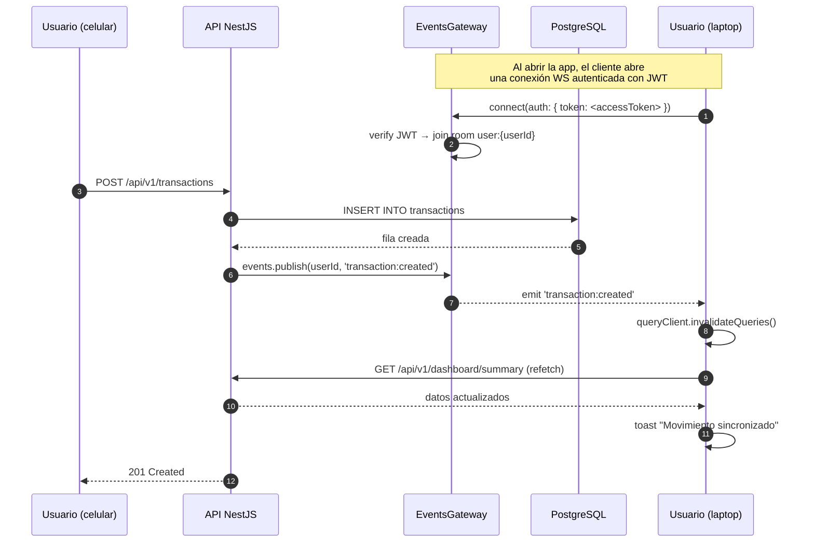
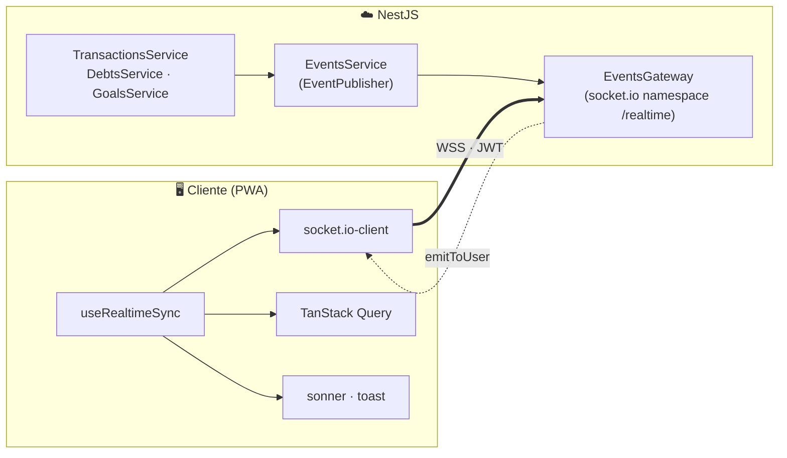
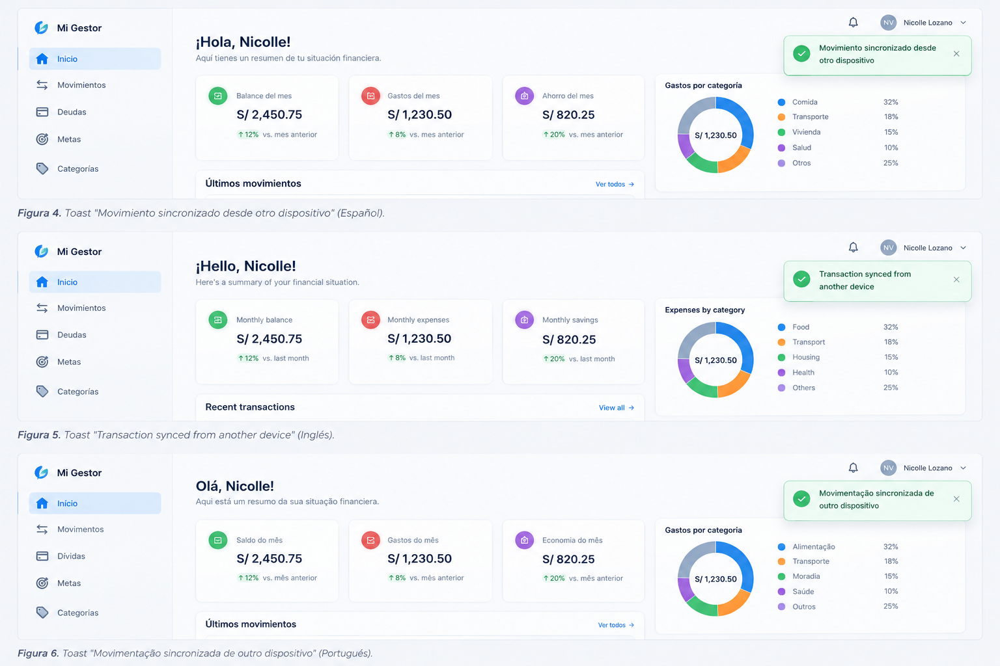

# Entrega — WebSockets en el Gestor Económico Personal

**Curso:** Tecnologías de Construcción de Software  
**Tema:** WebSockets — comunicación bidireccional en tiempo real  
**Alumno:** Nicolle Lozano
---

## 1. Característica implementada

### 1.1 Nombre

**Sincronización en vivo entre dispositivos.**

### 1.2 Descripción

Cuando el usuario tiene el Gestor abierto en **dos o más dispositivos**
(por ejemplo, la PWA instalada en el celular y la web en la laptop), cualquier
cambio que realice en uno de ellos **se refleja automáticamente** en los demás,
sin necesidad de recargar la página ni esperar a un refresco periódico.

### 1.3 Caso de uso real

María está revisando su dashboard en la laptop. Mientras tanto, desde su
celular registra un gasto de `S/ 35,50` en "Comida". En la laptop:

- El KPI **"Gastos del mes"** se actualiza de inmediato.
- El gráfico **donut de gastos por categoría** se redibuja.
- La lista de **"Últimos movimientos"** incluye el nuevo gasto.
- Aparece un toast: **"Movimiento sincronizado desde otro dispositivo"**.

Todo ocurre en menos de **100 ms**, sin que María toque nada en la laptop.

### 1.4 ¿Por qué WebSockets y no polling?

| Criterio | Polling cada 5 s | WebSockets |
|---|---|---|
| Latencia | Hasta 5 s | < 100 ms |
| Carga del servidor | 12 req/min por cliente | 1 conexión persistente |
| Consumo de batería (móvil) | Alto | Bajo |
| Bidireccionalidad | No | Sí |
| Escalabilidad con N clientes | O(N × 12) req/min | O(N) conexiones |

### 1.5 Naturaleza stateful del servidor

Con WebSockets, el backend pasa a ser **parcialmente stateful**:

- Mantiene un mapa en memoria: `userId → Set<SocketId>`.
- Cada usuario se une a un **room** (`user:{userId}`) al autenticarse.
- Cuando un servicio muta datos, emite al room correspondiente.

Esto **no contradice** la arquitectura REST/JWT del PRD: el estado HTTP sigue
siendo stateless; el estado WebSocket vive solo en el proceso que atiende la
conexión. En producción con múltiples instancias se usaría el **adapter de
Redis** de socket.io para compartir rooms entre nodos (fuera de alcance v1).

---

## 2. Arquitectura

### 2.1 Diagrama de secuencia



### 2.2 Diagrama de componentes (WebSocket)



### 2.3 Eventos emitidos

| Evento | Se emite cuando | Invalida en el cliente |
|---|---|---|
| `transaction:created` | Se crea un movimiento | `transactions`, `dashboard`, `debts` |
| `transaction:updated` | Se edita un movimiento | `transactions`, `dashboard` |
| `transaction:deleted` | Se elimina un movimiento | `transactions`, `dashboard` |
| `transaction:cleared` | Se vacía el historial | `transactions`, `dashboard` |
| `debt:created` / `updated` / `deleted` | Cambios en deudas | `debts`, `dashboard` |
| `debt:payment:added` / `removed` | Pago/cobro de deuda | `debts`, `dashboard`, `transactions` |
| `goal:created` / `updated` / `deleted` | Cambios en metas | `goals`, `dashboard` |
| `goal:contribution:added` / `removed` | Aporte a meta | `goals`, `dashboard`, `transactions` |
| `category:created` / `updated` / `deleted` | Cambios en categorías | `categories`, `transactions` |
| `user:updated` | Cambio de perfil | `me`, `dashboard` |

---

## 3. Implementación

### 3.1 Backend

**Dependencias:**

```bash
npm install @nestjs/websockets @nestjs/platform-socket.io socket.io
```

**Estructura:**

```
backend/src/modules/events/
├── events.module.ts        # @Global — expone EVENT_PUBLISHER
├── events.gateway.ts       # Gateway socket.io, autenticación JWT, rooms
├── events.service.ts       # Implementación del puerto EventPublisher
└── dto/event-payloads.ts
```

**Autenticación:**

El cliente envía el `accessToken` en el handshake (`auth.token`). El gateway
verifica el JWT con `JwtService.verifyAsync()` y:

- Éxito → une al cliente al room `user:{userId}`.
- Fallo → `client.disconnect(true)`.

**Emisión:**

Los servicios inyectan `EVENT_PUBLISHER` (puerto) y llaman a `publish(userId,
event, payload)` después de cada mutación exitosa. Esto respeta la regla de
dependencia (§1.2 del PRD): los servicios no conocen socket.io.

### 3.2 Frontend

**Dependencias:**

```bash
npm install socket.io-client
```

**Estructura:**

```
frontend/src/features/realtime/
├── realtime-client.ts       # Singleton socket.io-client
└── useRealtimeSync.ts       # Hook que escucha y invalida queries
```

**Activación:**

`useRealtimeSync()` se llama **una vez** en `App.tsx`. Cuando el usuario se
autentica, el hook abre la conexión; cuando cierra sesión, la cierra.

**Reacción:**

Cada evento invalida los `queryKeys` correspondientes en TanStack Query. Como
TanStack Query ya está configurado con `refetchOnWindowFocus: true`, el refetch
es instantáneo y transparente para la UI.

**Toast:**

Cada evento muestra un `toast.info` traducido al idioma activo (es/en/pt).

---

## 4. Evidencia de ejecución

### 4.1 Toast en tres idiomas

  
---

## 5. Manejo de errores y reconexión

| Situación | Comportamiento |
|---|---|
| Pérdida de conexión | socket.io reintenta automáticamente con backoff exponencial (1 s, 2 s, 4 s…). |
| Token expirado | El gateway cierra la conexión; el hook la reabre con el `accessToken` renovado tras el refresh. |
| Servidor caído | El cliente muestra el indicador gris "Sin sincronización en vivo"; el resto de la app sigue funcionando (fallback a REST). |
| Evento perdido | Al reconectar, TanStack Query invalida **todo** el caché (`queryClient.invalidateQueries()`) para garantizar consistencia. |
| Múltiples pestañas | Cada pestaña abre su propia conexión; todas reciben los eventos y actualizan su caché local. |

---

## 6. Conclusiones

- Se implementó **comunicación bidireccional en tiempo real** con `socket.io`
  entre el frontend y el backend.
- El backend ahora es **parcialmente stateful** (mantiene rooms por usuario),
  pero sin romper la arquitectura REST/JWT del PRD.
- La integración respeta la **arquitectura de puertos y adaptadores**: los
  servicios dependen de `EventPublisher` (interfaz), no de socket.io.
- El frontend **reacciona en < 100 ms** a los cambios, invalidando selectivamente
  las queries de TanStack Query y mostrando un toast traducido.
- La funcionalidad es **multi-idioma** (es/en/pt) y **resiliente** (reconexión
  automática, fallback a REST, invalidación completa al reconectar).

---

## 7. Referencias

- Documentación oficial de NestJS WebSockets:
  <https://docs.nestjs.com/websockets/gateways>
- Documentación oficial de socket.io: <https://socket.io/docs/v4/>
- Documentación de TanStack Query: <https://tanstack.com/query/latest>
- Especificación del proyecto: `SPEC.md` (§1.2 — regla de dependencia;
  §5.1 — estado del cliente; §5.2 — puertos y adaptadores).
- Decisión registrada en `docs/DECISIONS.md`: _"Se añade WebSockets con
  `socket.io` para sincronización en vivo entre dispositivos. El backend
  pasa a ser parcialmente stateful solo en la capa de eventos; la lógica
  de negocio sigue siendo pura y la persistencia sigue en PostgreSQL."_
